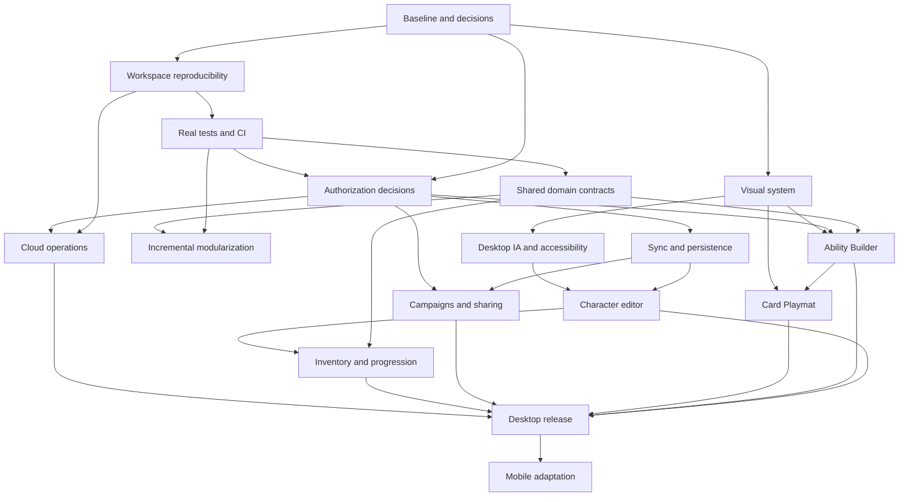

# Creosmark — Product Development Epics and Candidate Backlog

**Planning baseline:** 2026-10-19  
**Source repository:** [`Tsindwr/pantheon`](https://github.com/Tsindwr/pantheon), `sunder-platform/apps/creosmark`  
**Audited HEAD:** `62eac0ebfef436f8542fee3f4cf0bf1b773db2d1`, **with material uncommitted local changes**  
**Status:** Proposed product plan for discussion, not authorized implementation or a claim of issue creation.  
**Primary target:** A stable, coherent, professional **desktop browser application**. Mobile product work is deliberately last.

## 1. Evidence, constraints, and planning principles

This plan draws primarily from the 2026-10-19 repository agent handoff:

- `Creosmark_Current_State_and_Architecture_Audit.md` — verified source, browser, build and read-only Supabase findings.
- `Creosmark_Development_Opportunities.md` — DEV, DATA, AUTH, REL, ARCH, UX, FUNC and DOC findings.
- `Creosmark_Shared_Package_Dependency_Map.md` — actual shared imports and ownership boundaries.
- `Creosmark_Priority_File_Index.md` — 71 important file references and review groupings.
- `Creosmark_Screenshot_Index.md` and `screenshots/` — production, current-build preview and development browser observations.
- The supplied GitHub issue screenshots — an **existing UX candidate backlog**, including UX-001 onward. These screenshots demonstrate proposed issues, **not** verification of their implementation status or exact current GitHub metadata.
- `Pantheon_Repository_Context_Handoff_2026-10-19.md` — broader monorepo context.

### Material findings shaping the plan

1. **The application is not a blank slate.** The public Ability Builder and demo sheet have meaningful behavior. Existing `@sunderttrpg/core` and `@sunderttrpg/experience-market` already own much of the mechanical logic. Avoid a speculative rewrite or wholesale migration.
2. **Reproducibility is not yet proven.** The audit found a missing Core `tsconfig.json`, locally untracked Schema/Discord repairs, pnpm/Astro version divergence, a checker that returns exit 0 without checking, and a lint command that runs zero tasks. A static build passed only with preexisting compiled shared packages.
3. **Live authorization and repository migration history disagree in consequential ways.** Nine recorded live migrations versus 21 repository files, with many later objects actually deployed. Unreconciled roll audiences, GM field permissions, content publication status, and Realtime publication must be resolved before broad multiplayer and data changes.
4. **Persistence needs deliberate guarantees.** The audited character page wrappers debounce whole-document writes for 700 ms without observed revision checks or durable recovery. Campaign creation, content publication and share replacement contain multistep writes.
5. **The desktop UX is mature enough to refine rather than replace.** Dark, gold and purple surfaces, card faces and circular trackers supply a recognizable identity. Navigation labels, feature styling, empty states, focus behavior and authoring complexity need consistency.
6. **Authenticated behavior remains largely unverified.** The agent explored guest routes and in-memory demo states, not signed-in creation, moderation, campaign collaboration or actual save/reload. PBI acceptance must therefore require controlled signed-in verification rather than asserting these flows are broken.
7. **Mobile is explicitly deferred.** The screenshots show real 390 px clipping, but extensive mobile redesign does not belong on the critical path for finishing the desktop browser product. Handle only defects with desktop/accessibility consequences early.

### Product decisions required before related implementation

| Decision | Why it matters | Proposed decision owner |
|---|---|---|
| Does a **Self** roll remain private from the GM, or does the GM always see it? | Main UI and live SELECT policy disagree. | Sunder rules/product owner |
| Can creators publish their own abilities/Origins, or must an administrator approve them? | UI moderation and database status permissions disagree. | Product owner |
| Which fields may a GM edit on a linked character? Can ownership ever change? | Database policy appears broader than the UI mutation adapter. | Product owner + engineering |
| Are characters allowed in multiple simultaneous campaigns? | SQL allows multiple links; current code chooses the first one. | Product owner |
| Which local Astro 7/Schema/Discord edits are intended and reviewed? | The present working tree is not equivalent to committed HEAD. | Repository maintainer |
| Is the Card Playmat intended as a play surface with full action tracking or primarily an ability viewer? | Determines interaction model and scope of Playmat tickets. | Product owner |
| What does **desktop complete** mean for launch: which authenticated journeys must be supported? | Prevents optional UX polish from indefinitely delaying release. | Product owner |

### Priority taxonomy

- **P0 — Blocker:** prevents reproducible or trustworthy development, compromises necessary authorization, or blocks a critical release journey.
- **P1 — Required desktop capability:** important correctness, reliability, accessibility, or usability work needed for the agreed desktop release.
- **P2 — Improvement:** valuable but deferrable enhancement or architectural refinement.
- **P3 — Future:** exploratory or explicitly postponed, including most mobile work.

Epic ordering denotes dependencies, **not** a demand to finish every P2 item before the next epic. Multiple epics can progress concurrently after the relevant safety gates pass. Estimates are deliberately relative; backlog items need refinement before effort estimates or commitments.

## 2. Proposed epic portfolio

| Epic | Outcome | Relative scope | Proposed window | Primary dependencies |
|---|---|---|---|---|
| **CR-E00** Product Baseline & Decision Register | Verified product scope and unified backlog | M | Wave 0 | None |
| **CR-E01** Workspace & Delivery Reproducibility | Clean, deterministic source builds | M | Wave 0 | E00 |
| **CR-E02** Quality Engineering & Test Foundations | Actual pass/fail safety gates | L | Waves 0–1 | E01 |
| **CR-E03** Data Governance & Authorization | Coherent database/security contracts | L | Wave 1 | E00, E02 |
| **CR-E04** Persistence, Realtime & Synchronization | Reliable saves and collaboration | L | Waves 1–2 | E02, E03 |
| **CR-E05** Canonical Sunder Domain Packages | Reusable tested mechanics and schemas | L | Waves 1–2 | E01, E02, E00 rules decisions |
| **CR-E06** Modular Architecture & Design Patterns | Maintainable seams without rewriting | L | Waves 1–3 | E02, E05 where relevant |
| **CR-E07** Visual System & Professional Polish | Cohesive desktop visual language | M–L | Waves 2–3 | E00 |
| **CR-E08** Desktop Navigation, UX & Accessibility | Discoverable, operable core journeys | L | Waves 2–3 | E07, E03 where relevant |
| **CR-E09** Character Creation & Editor | Clear, reliable character workflow | L | Waves 2–3 | E03, E04, E05, E06, E08 |
| **CR-E10** Ability Builder & Authoring Workflow | Comprehensible graph/card/publish lifecycle | XL | Waves 2–4 | E02, E03, E05, E06, E07 |
| **CR-E11** Card Playmat & In-Session Experience | Purposeful, responsive desktop play interface | L | Waves 2–4 | E05, E07, E08, E10 |
| **CR-E12** Campaigns, GM Tools & Content Lifecycle | Dependable shared campaigns and moderation | L | Waves 2–4 | E03, E04, E10 |
| **CR-E13** Inventory, Equipment & Progression | Consistent character equipment/resource models | M–L | Waves 2–4 | E02, E05, E09 |
| **CR-E14** Cloud Operations & Cost-Conscious Integrations | Observable, sustainable operations | M | Waves 1–4 | E01, E03, E04 |
| **CR-E15** Desktop Release Hardening & Bug Closure | Desktop release candidate with evidence | L | Wave 4 | Required P0/P1 work from E01–E14 |
| **CR-E16** Mobile Strategy & Later Adaptation | Planned mobile product, not current diversion | L (deferred) | Wave 5+ | E15 |

**Waves:** 0 = baseline/safety; 1 = secure contracts and foundations; 2 = core desktop journeys; 3 = interface/content refinement; 4 = verification and release; 5+ = mobile. These are logical stages, not calendar promises.

---

## 3. Epic definitions and proposed PBI topics

Candidate IDs such as `E01-01` are **planning identifiers**, not newly created GitHub issues. During refinement, reuse relevant existing `UX-*` issues rather than filing duplicates. PBI topics are intentionally short; acceptance details are defined at epic level and should be elaborated when the epic begins.

### CR-E00 — Product Baseline & Decision Register

**Goal:** Establish a versioned, agreed view of the application and its intended desktop workflows; reconcile the audit against the actively edited repository and existing GitHub issues.

**Definition of done:** A source/working-tree baseline is selected; the seven product decisions above are recorded or explicitly deferred with owners; existing UX issues are classified without duplication; a desktop critical-journey inventory exists with known verification gaps.

**Candidate PBIs**

- **E00-01 [P0]** Reconcile the 256-entry working tree with HEAD: group functional work, generated files, intended tool upgrades, and untracked fixes without deleting work.
- **E00-02 [P1]** Publish a compact Creosmark product charter: supported roles, principal personas, and what desktop release must accomplish.
- **E00-03 [P1]** Inventory existing GitHub UX issues, preserve their IDs/tags/phase labels, record current statuses, and map them to these epics.
- **E00-04 [P1]** Establish a controlled test account/role matrix and safe fixtures for character, GM, player and admin journeys.
- **E00-05 [P1]** Decide Self roll visibility, publication approval, GM edit scope, campaign membership semantics and demo versus product scope.
- **E00-06 [P2]** Establish a lightweight architectural decision record (ADR) and product decision log; record rejected approaches and evidence links.
- **E00-07 [P2]** Define desktop release metrics and a maintained defect/unknown register, separating code evidence from tested behavior.

**Anchors:** Audit §§1–4, opportunity register; `src/lib/routing.ts`, current issues, screenshot index.

### CR-E01 — Workspace & Delivery Reproducibility

**Goal:** Make a fresh, unprivileged checkout sufficient to install, type-check and build Creosmark and its source dependencies.

**Definition of done:** A clean checkout in a supported runtime completes a frozen dependency install, Core/Market/Schema checks and Creosmark check/build with no preexisting `dist`; CI records artifacts and fails on genuine errors. Existing local changes are preserved and reviewed.

**Candidate PBIs**

- **E01-01 [P0]** Restore Core's declared `tsconfig.json` and validate its subpath exports from source.
- **E01-02 [P0]** Reconcile and commit or replace intended Schema/Discord manifest/source repairs, with correct lockfile and workspace graph.
- **E01-03 [P1]** Resolve pnpm 11.13.1/11.22.0/11.1.3 drift and define a supported Node/TypeScript/Astro version matrix.
- **E01-04 [P1]** Repair Astro configuration and install the actual checker; make nonchecking exit 0 impossible.
- **E01-05 [P1]** Add nonpublishing PR CI for frozen install, package checks, app checks and app build.
- **E01-06 [P2]** Introduce meaningful lint/format tasks; prohibit a zero-task lint result from appearing successful.
- **E01-07 [P2]** Remove tracked dependency and generated files only after source build is proven; reconcile the stale npm lockfile.
- **E01-08 [P2]** Replace the starter README with exact setup/build/deployment instructions and configuration safety notes.

**Anchors:** DEV-01/02/03/04, DOC-01; `sunder-platform/package.json`, `pnpm-lock.yaml`, `turbo.json`, `packages/core`, `packages/schema`, `.github/workflows/publish-creosmark-pages.yml`.

### CR-E02 — Quality Engineering & Test Foundations

**Goal:** Supply fast, deterministic regression evidence for rules, data authorization and the highest risk UI journeys.

**Definition of done:** The relevant PR checks fail on introduced errors; representative Core/Market/character tests run from a fresh checkout; a browser smoke suite runs against a safe environment; every asserted passing check records execution evidence.

**Candidate PBIs**

- **E02-01 [P1]** Adopt and configure one unit testing framework with deterministic fixtures and package scoped test commands.
- **E02-02 [P1]** Migrate the audit's Core comparison diagnostics into maintained tests, then cover natural results, perks, rerolls, Charge, Fallout and Recollect.
- **E02-03 [P1]** Add Experience Market golden price/preset/prerequisite/validation tests including invalid and cyclic references.
- **E02-04 [P1]** Test character invariants, Origin bonuses, resource transitions, inventory derivation and backward compatible sheet normalization.
- **E02-05 [P1]** Add Supabase policy and database contract tests in a controlled disposable/test project, including negative role cases.
- **E02-06 [P1]** Automate guest navigation and authenticated critical browser journeys with nonproduction fixtures; include save/reload and two client scenarios.
- **E02-07 [P2]** Add regression cases for builder undo/redo, document publication gates, Playmat interactions and overlay keyboard behavior.
- **E02-08 [P2]** Establish screenshot regression baselines, error capture, CI summaries and an explicit flaky-test policy.

**Anchors:** REL-03/04; audit §9; `packages/core/src/rolling`, `packages/experience-market/src/pricing.ts`, `src/application/character-sheet/commands.ts`.

### CR-E03 — Data Governance & Authorization

**Goal:** Make persistence migrations, roles and sensitive lifecycle transitions coherent, enforceable and reproducible.

**Definition of done:** A schema-only live baseline and reconciled migration strategy exist; product role decisions are encoded at the data boundary; owner/GM/player/admin/guest positive and negative tests pass in a controlled environment; no production authorization migration is applied without separate review.

**Candidate PBIs**

- **E03-01 [P0]** Reconcile nine live migration ledger entries with 21 repository migration files and live objects without blindly replaying SQL.
- **E03-02 [P1]** Decide and enforce Self/GM/everyone roll visibility consistently across RLS, UI and history.
- **E03-03 [P1]** Define draft, review, published and rejected content transitions for abilities and Origins; enforce actual publication authority below the UI.
- **E03-04 [P1]** Constrain linked-character GM writes to approved fields and guarantee ownership immutability absent an explicit transfer flow.
- **E03-05 [P1]** Verify campaign and character linkage authorizations, roles, join RPCs and sharing revocation using a role matrix.
- **E03-06 [P2]** Audit helper execute grants, table privileges and SECURITY DEFINER search paths; distinguish exposed access from merely broad grants.
- **E03-07 [P2]** Introduce typed Supabase DB model generation and reviewed migration/rollback documentation.
- **E03-08 [P2]** Define confidential data, retention and deletion expectations for users, characters, roll history and shared content.

**Anchors:** DATA-01, AUTH-01/02/03/04; `supabase/migrations`, `src/lib/supabase/db.ts`, `src/infrastructure/library/abilities.ts`, live-policy audit metadata.

### CR-E04 — Persistence, Realtime & Synchronization

**Goal:** Prevent avoidable state loss and make collaborative features update predictably across clients.

**Definition of done:** Autosave failures expose recoverable status; concurrent edits follow an explicit policy and are tested; Realtime publication/subscription is verified for intended tables; multistep writes are atomic or compensate safely; roll history selects the intended records.

**Candidate PBIs**

- **E04-01 [P1]** Define a sheet save state contract (`clean`, `dirty`, `saving`, `saved`, `error`, `conflict`) and visible recovery UX.
- **E04-02 [P1]** Add revision/conflict detection to whole-sheet saves; determine merge, prompt or exclusive edit behavior for player/GM concurrency.
- **E04-03 [P1]** Ensure route changes and interrupted saves do not silently discard edits; queue/retry only safe idempotent operations.
- **E04-04 [P1]** Reconcile `supabase_realtime` publication with subscribed `roll_events`, `campaign_looms` and `campaign_gm_tools`; exercise two account sessions.
- **E04-05 [P1]** Move campaign creation with membership, ability publication and share replacement to appropriate atomic transaction/RPC or explicit compensation boundaries.
- **E04-06 [P1]** Establish one reusable subscription lifecycle strategy with cleanup, reconnect behavior, duplicate-event suppression and stale snapshot handling.
- **E04-07 [P2]** Fix roll history recent-first ordering, pagination and deterministic multi-campaign selection.
- **E04-08 [P2]** Evaluate optimistic party-state updates, conflict handling and diagnostic correlation IDs without exposing character private data.

**Anchors:** DATA-02, REL-01/02/05; `CharacterSheetFromDb.tsx`, `CharacterBuilderPageEntry.tsx`, `src/lib/supabase/db.ts`, campaign/roll infrastructure.

### CR-E05 — Canonical Sunder Domain Packages

**Goal:** Strengthen already shared Core/Experience Market and move only proven reusable rules out of Creosmark.

**Definition of done:** A written symbol ownership matrix identifies canonical Core, Market, Schema and application responsibilities; any migrated pure function has parity tests, clear exported contracts and no UI/Supabase coupling. Existing facades continue to work until call sites are migrated safely.

**Candidate PBIs**

- **E05-01 [P1]** Document canonical roll/success/Volatility/perk/Fallout ownership and settle uncovered edge-case rules before changing mechanics.
- **E05-02 [P1]** Formalize Experience Market pricing, targeted issue identifiers, prerequisites, activation/reset and budget contracts with fixtures.
- **E05-03 [P2]** Consolidate pure prerequisite extraction/evaluation and cycle handling while leaving queries and pickers in Creosmark.
- **E05-04 [P2]** Version rich character, card, Origin and campaign JSON at the Schema boundary with parsers/migration strategy; avoid duplicating Core enums.
- **E05-05 [P2]** Evaluate extraction of character progression/resource transitions to Core based on demonstrated cross-app reuse.
- **E05-06 [P2]** Evaluate equipment property/derivation and Party Loom formulas for shared ownership, with domain tests and actual consumers.
- **E05-07 [P2]** Inventory and reduce redundant compatibility reexports only after verifying consumers; preserve deliberate compatibility adapters.
- **E05-08 [P3]** Plan shared rules prose/data consistency between Creosmark `ruleset`, Core and the Sunder documentation site without inventing a second runtime rules engine.

**Anchors:** ARCH-02/03/04, REL-03/04; package dependency map; `packages/core`, `packages/experience-market`, `packages/schema`.

### CR-E06 — Modular Architecture & Applicable Design Patterns

**Goal:** Reduce costly coupling and large change surfaces while retaining the functioning Astro/React/Supabase architecture.

**Definition of done:** Target modules gain smaller responsible boundaries and tests without user-visible regression; the team documents where selected patterns apply and where they would add unnecessary abstraction.

**Candidate PBIs**

- **E06-01 [P1]** Extract coherent sections and pure model transformations from `EditorWorkspace.tsx` (~4,425 lines) without changing its seven-step behavior.
- **E06-02 [P1]** Split AbilityBuilderShell orchestration from validation interpretation, UI modes, command dispatch and persistence coordination.
- **E06-03 [P2]** Consolidate existing **Repository + Adapter** contracts around Supabase, reducing overlap between infrastructure adapters and `lib/supabase/db.ts`.
- **E06-04 [P2]** Standardize **Command** use cases for meaningful character and content transitions; isolate side effects for testability.
- **E06-05 [P2]** Model complex builder publication, save and roll UI lifecycles as explicit typed **state machines** where ambiguous status combinations currently cause defects.
- **E06-06 [P2]** Use **Strategy/Policy** interfaces only for genuine variations (e.g. rule evaluation/role dependent behavior), not for every rule function.
- **E06-07 [P2]** Introduce typed **Factory/Normalizer** boundaries for rich persisted documents and remove duplicated ad hoc hydration safely.
- **E06-08 [P2]** Define module ownership, component contracts, async/error boundary conventions and a lightweight dependency boundary check.
- **E06-09 [P3]** Remove proven unreachable legacy UI/fixtures only after import/reachability checks and screenshot regression coverage.

**Anchors:** ARCH-01; `EditorWorkspace.tsx`, `AbilityBuilderShell.tsx`, `lib/supabase/db.ts`, `application/`, `domain/`, `infrastructure/`, `presentation/`. Avoid premature global event buses, service locators or a second state management framework.

### CR-E07 — Visual System & Professional Polish

**Goal:** Make Creosmark unmistakably one product while retaining the purposeful tabletop character of its sheets, cards and Potential halos.

**Definition of done:** A documented visual foundation governs colors, type, spacing, surfaces, states and icons across all desktop critical journeys; reusable primitives demonstrate consistent focus/disabled/error states; changes are reviewed through before/after screenshots.

**Candidate PBIs**

- **E07-01 [P1]** Audit and codify the existing dark/gold/purple design tokens into a minimal semantic scale; document specialized Playmat/card variants.
- **E07-02 [P1]** Adopt intentional typography roles for navigation, body, figures, card faces and headings; fix inconsistent fallback and legibility.
- **E07-03 [P1]** Establish consistent button, input, select, badge, menu, card, tray, tooltip and dialog primitives with usage examples.
- **E07-04 [P1]** Standardize readable errors, loading, empty, success, disabled and unsaved states, including contrast and meaningful labels.
- **E07-05 [P2]** Replace inconsistent emoji/icon glyphs with a coherent icon treatment where suitable; retain deliberate game symbols.
- **E07-06 [P2]** Normalize page width, spacing, grid, visual rhythm, border/radius and control density across home, editor, builder, campaigns and play.
- **E07-07 [P2]** Remove or isolate unused MkDocs-era selectors and conflicting CSS only after verifying app route imports.
- **E07-08 [P2]** Develop screenshot references and desktop visual acceptance checks for critical states and representative viewports.

**Anchors:** UX-04/05, UX-027; `src/styles/sunder-theme.css`, AppShell.module.css, feature CSS, production and preview screenshots.

### CR-E08 — Desktop Navigation, UX & Accessibility

**Goal:** Make core workflows easy to find, understand and complete with a mouse or keyboard on desktop.

**Definition of done:** Intended users can locate Characters, Campaigns, Create/Ability authoring, Play and Account without misleading labels; primary dialogs/trays have predictable focus behavior; navigation, error and feedback states are consistent; a keyboard journey audit has no unresolved critical blockers.

**Candidate PBIs**

- **E08-01 [P1]** Clarify navigation terminology: `/create` creates content, `/abilities` opens an editor, while New Character lives in the authenticated library.
- **E08-02 [P1]** Replace duplicate guest welcome/sign-in presentations with a clear landing hierarchy; provide useful signed-out orientation.
- **E08-03 [P1]** Establish accessible initial focus, containment where appropriate, Escape close and focus return for SideTray and important modals.
- **E08-04 [P1]** Give pointer-only halo actions keyboard equivalents and ensure icon-only controls have meaningful accessible names.
- **E08-05 [P1]** Standardize form validation, inline help, recovery affordances, submit/status messaging and disabled-action explanations.
- **E08-06 [P2]** Define reusable navigation/route error/empty state patterns for missing IDs, sign-in gates and restricted admin pages.
- **E08-07 [P2]** Decide supported status for `/calc`, `/sheet` and `/sunder-demo`; label or isolate experimental routes appropriately.
- **E08-08 [P2]** Curate short contextual onboarding/help, including Scription-linked pages where applicable without changing entitlement logic blindly.

**Existing screenshot backlog to map, not duplicate:** UX-025 (keyboard traversal), UX-026 (modal focus), UX-027 (contrast), UX-028 (icon control labels), UX-017 (helper text), and other shared navigation tickets.

**Anchors:** UX-02/03/05/06; `src/components/app/AppShell.tsx`, NavBar, AuthStatus, SideTray; audit §5.

### CR-E09 — Character Creation & Editor

**Goal:** Turn the complex seven-step editor into a comprehensible, efficient desktop character lifecycle without sacrificing Sunder depth.

**Definition of done:** In a safe signed-in environment, a player can create a character, complete required sections, recover from validation errors, save, reopen, edit and enter play; an authorized GM can perform only approved edits. The editor communicates progress and unsaved states.

**Candidate PBIs**

- **E09-01 [P1]** Establish one coherent progress model and in-page location affordance across editor steps, tabs and long sections (existing UX-001/002).
- **E09-02 [P1]** Add section summaries, readiness and actionable validation messages that reflect actual domain requirements (UX-007, UX-033).
- **E09-03 [P1]** Integrate explicit save state, retry/recovery and exit guards with the E04 persistence contract (UX-019/020).
- **E09-04 [P1]** Exercise and repair real character creation/edit/view journeys for owner and approved GM, including missing-ID/error states.
- **E09-05 [P2]** Add a first-run checklist, progressive disclosure and contextual guidance without duplicating rules prose (UX-006/015).
- **E09-06 [P2]** Improve common-field editing, skill/proficiency bulk operations and keyboard navigation (UX-009/010).
- **E09-07 [P2]** Reduce editor rendering and state orchestration complexity as E06 extracts stable section boundaries.
- **E09-08 [P2]** Clarify level/progression/Origin effects and surface their consequences before the user commits a choice.

**Anchors:** existing UX-001/002/006/007/009/010/015/019/020/033; `CharacterBuilderShell.tsx`, `EditorWorkspace.tsx`, `application/character-sheet/commands.ts`, `domain/character-sheet/invariants.ts`.

### CR-E10 — Ability Builder & Authoring Workflow

**Goal:** Transform the existing powerful but dense graph/card editor into an understandable workflow with dependable rules and publication semantics.

**Definition of done:** From a safe test account, a creator can start an ability, edit graph and card, understand prices and blockers, use undo/redo, save a draft, reopen it, and complete the intended publication/review path; rules tests and UI feedback agree. Desktop screens remain operable at supported widths.

**Candidate PBIs**

- **E10-01 [P1]** Define clear authoring stages for structure, rules, card and publication without destroying advanced free navigation (existing UX-003).
- **E10-02 [P1]** Reorganize the Ability Palette and distinguish templates, modifiers and expert controls with progressive disclosure.
- **E10-03 [P1]** Make price/budget/prerequisite issue presentation consistent with Market's canonical rule IDs; expose remediation guidance.
- **E10-04 [P1]** Reconcile draft/upload/review/published status and the two-step ID update with E03/E04; surface ownership and visibility truthfully.
- **E10-05 [P1]** Repair ability/card editing regressions identified by controlled signed-in tests and guarantee undo/redo parity for graph + card changes.
- **E10-06 [P2]** Add starter templates organized by author intent and practical examples (UX-016).
- **E10-07 [P2]** Add keyboard palette search/creation, snap alignment, layout aids and optional shortcuts (UX-011/012).
- **E10-08 [P2]** Improve informative placeholder states, lazy graph/card rendering and perceived latency, using measurements rather than animation alone.
- **E10-09 [P2]** Strengthen card previews, prerequisite picker, Origin budgets, self-target overlays, and publish blocking issue navigation.
- **E10-10 [P2]** Evaluate postpublication ownership, assignment-to-character and management UX without bypassing authorization (issues shown in supplied board).

**Anchors:** existing UX-003/011/012/016/017 and builder/publish tickets; `AbilityBuilderShell.tsx`, `presentation/abilities/hooks`, `domain/ability-builder`, `src/application/ability-builder/publishAbilityToSite.ts`, `packages/experience-market`.

### CR-E11 — Card Playmat & In-Session Experience

**Goal:** Make the play surface immediately useful for finding, presenting and applying abilities and actions during a desktop session.

**Definition of done:** With realistic fixture characters, players can distinguish available actions, inspect and activate eligible cards, understand spend/cooldown/priority consequences, access roll/Fallout feedback and navigate without modal confusion. Mechanical effects match documented game rules and command tests.

**Candidate PBIs**

- **E11-01 [P1]** Define Playmat zones, turn priority, action economy and readiness semantics before reshaping the interface (UX-005/008).
- **E11-02 [P1]** Establish reliable visual distinction between ready, situational, used, blocked and unavailable cards with accessible explanations.
- **E11-03 [P1]** Improve action-use feedback, cost/cooldown badges and Recollect validation hints without inventing unimplemented rules (UX-023/024).
- **E11-04 [P1]** Verify roll composer, result application, Fallout decisions and card-triggered sheet changes on realistic authenticated/test fixtures.
- **E11-05 [P2]** Improve pinning, preview/flip affordances, selection behavior and user control over spotlight overlays (UX-013/014).
- **E11-06 [P2]** Provide dismissible, optional Playmat orientation and contextual help (UX-004/018).
- **E11-07 [P2]** Define the intended relationship between Card Playmat, regular Actions, equipment and custom abilities; avoid duplicate action-state stores.
- **E11-08 [P2]** Tune density, hit targets, card grouping and responsiveness for desktop and compact laptop widths; mobile tactile layouts belong in E16.

**Anchors:** existing UX-004/005/008/013/014/018/023/024; `src/components/shell/CharacterSheetShell.tsx`, Playmat components, `src/components/roll/`, Core rolling.

### CR-E12 — Campaigns, GM Tools & Custom Content Lifecycle

**Goal:** Deliver coherent multiplayer campaign administration, sharing and content governance across character, GM, Loom and authoring features.

**Definition of done:** In controlled authenticated tests, owner/GM/player roles can create/join/view campaigns as permitted, share/revoke abilities and Origins, use intended GM/Loom functions and receive updates; unauthorized paths are rejected by database policy.

**Candidate PBIs**

- **E12-01 [P1]** Validate campaign creation/join/roster/link/unlink and role assignment end to end, including multistep transaction failure cases.
- **E12-02 [P1]** Complete permissions and usable feedback for GM tools, owner settings and shared Party Loom operations.
- **E12-03 [P1]** Verify ability/Origin draft sharing, share-all behavior, revoke behavior and prerequisite availability across campaign roles.
- **E12-04 [P1]** Establish moderation workflow states, admin review ergonomics and user notification after approval/rejection, aligned with E03 decisions.
- **E12-05 [P1]** Repair and test intended campaign roll/feed and party-state Realtime delivery through E04.
- **E12-06 [P2]** Make campaign context deterministic for characters linked to multiple campaigns, or enforce a single-campaign product rule.
- **E12-07 [P2]** Improve GM dashboard information hierarchy, member selection, campaign activity feedback and empty states after authenticated screenshot review.
- **E12-08 [P2]** Design role-appropriate audit/history views for impactful changes without exposing private rolls or internal security metadata.

**Anchors:** `src/components/campaign/`, `src/infrastructure/library/`, `src/lib/campaign-loom.ts`, custom sharing SQL, AUTH/DATA/REL audit findings.

### CR-E13 — Inventory, Equipment & Progression

**Goal:** Give character resources and equipment a consistent, understandable rules model across creation, editing and play.

**Definition of done:** Equipment/character state transitions use tested invariants; inventory edits persist and reopen correctly; derived statistics and resource changes remain consistent between editor and play; known destructive/missing-reference cases are handled.

**Candidate PBIs**

- **E13-01 [P1]** Build equipment/slot/category invariants and tests for equip/unequip, containers, currency and removal edge cases.
- **E13-02 [P1]** Validate derived attacks/armor, resource tracks and proficiency interactions between inventory and sheet views.
- **E13-03 [P1]** Verify inventory persistence, normalization and references when moving between editor and Playmat.
- **E13-04 [P2]** Unify catalog/property vocabulary and separate pure equipment rules from picker/control presentation.
- **E13-05 [P2]** Improve compact inventory browsing, search, add/manage affordances, empty slots and equipment feedback.
- **E13-06 [P2]** Clarify progression eligibility and Undo/rollback expectations for resource and character advancement changes.
- **E13-07 [P2]** Decide Notes scope (currently explicitly 'Coming next') and implement only if included in desktop release definition.

**Anchors:** `src/application/inventory/`, `src/domain/inventory/`, `src/components/inventory/`, `src/application/experience/`, screenshot inventory panels, FUNC-01.

### CR-E14 — Cloud Operations & Cost-Conscious Integrations

**Goal:** Operate Creosmark reliably using existing infrastructure first, adopting additional low-cost/free capabilities only when measurable needs justify them.

**Definition of done:** Hosting, public configuration, deployment provenance, database limits, secrets, rollback and nonpersonal observability are documented and exercised; each proposed service has a cost/limit, privacy, maintenance and exit assessment. No unbudgeted third-party dependency is silently introduced.

**Candidate PBIs**

- **E14-01 [P1]** Verify the current Pantheon → external Creosmark `gh-pages` pipeline, custom domain and active Pages source settings; plan retirement of competing legacy publisher safely.
- **E14-02 [P1]** Establish reproducible environment configuration for local, test and production, with separate Supabase projects/roles where practical.
- **E14-03 [P1]** Define public configuration and secret-handling standards for Astro static build, OAuth, GitHub Actions and Supabase.
- **E14-04 [P1]** Add useful nonprivate error diagnostics, logging/correlation and deployment identification to debug runtime failures.
- **E14-05 [P2]** Assess Supabase quotas, Realtime usage, database growth, authentication limits and backup/restore options; produce a resource budget.
- **E14-06 [P2]** Evaluate whether existing Supabase RPC/Edge Functions satisfy atomic actions before adding a separate API, worker or cloud service.
- **E14-07 [P2]** Evaluate privacy conscious error reporting, analytics and lightweight uptime monitoring with available free tiers; document limitations and exit paths.
- **E14-08 [P2]** Establish release notes, deployment smoke checks, safe rollback, dependency updates and notification expectations.
- **E14-09 [P3]** Explore optional CDN, image optimization, remote configuration or other free integrations only after a measured bottleneck/user need is demonstrated.

**Notes:** Supabase, GitHub Pages/Actions and the existing Sunder services are **current architecture**. Cloudflare Workers, third-party error trackers and other free services are **evaluation candidates**, not verified Creosmark dependencies; current free quotas and privacy terms must be checked during PBI refinement.

**Anchors:** `.github/workflows/publish-creosmark-pages.yml`, `.github/actions/publish-public-gh-pages/action.yml`, `astro.config.mjs`, `src/lib/supabase/client.ts`, audit §§2, 8–9.

### CR-E15 — Desktop Release Hardening & Bug Closure

**Goal:** Finish the desktop browser product against explicitly accepted workflows and verifiable quality gates.

**Definition of done:** Every agreed desktop critical journey is demonstrated on the intended deployment with role-safe test records; all P0 and release blocking P1 defects are closed or have owner-approved mitigations; CI, build, migration, authorization, recovery, keyboard and deployment evidence is archived; known limitations are documented.

**Candidate PBIs**

- **E15-01 [P1]** Define and run a desktop release test matrix: new/returning player, campaign GM, content creator and admin.
- **E15-02 [P1]** Retest every audit issue and existing UX ticket against current production and current-source preview; separate fixed, reproduced, unverified and deferred.
- **E15-03 [P1]** Close release blocking save, permissions, navigation, builder, play and moderation defects with regression tests.
- **E15-04 [P1]** Profile bundle/chunk loading, builder interaction delays and main-route responsiveness; prioritize observed bottlenecks, not warning counts alone.
- **E15-05 [P1]** Perform a desktop keyboard and accessible semantics review of high-use flows and resolve critical issues.
- **E15-06 [P1]** Validate deployment provenance, OAuth callback, custom domain, Supabase configuration and postdeployment smoke behavior.
- **E15-07 [P2]** Review error/empty/demo/unsupported states and replace misleading or silent no-op controls.
- **E15-08 [P2]** Publish a known limitations record, support/debug instructions, release checklist and next-cycle opportunities.

**Anchors:** all prior epic exit evidence, screenshot and issue indexes, audit's blocked authenticated journeys and production source mismatch.

### CR-E16 — Mobile Strategy & Later Adaptation (explicitly deferred)

**Goal:** Prepare a coherent future mobile experience without compromising completion of the desktop browser application.

**Entry gate:** The desktop release candidate has passed E15; product owner explicitly authorizes mobile scope. Only narrowly scoped critical accessibility issues shared with desktop may move earlier.

**Candidate PBIs**

- **E16-01 [P3]** Define mobile personas, touch use cases and whether feature parity with desktop authoring is desirable.
- **E16-02 [P3]** Resolve the observed 390×844 clipped navigation, sign-in and builder content with deliberate mobile information architecture.
- **E16-03 [P3]** Design compact editor section chunking and sticky actions, and mobile graph/card authoring modes (existing UX-029/030).
- **E16-04 [P3]** Design Playmat touch spacing, tactile interaction and small-screen card controls (existing UX-031/032).
- **E16-05 [P3]** Evaluate PWA/offline support versus a separate mobile app; do not assume native app development is required.
- **E16-06 [P3]** Test real touch devices, keyboard appearance, safe areas, reduced motion, focus and assistive technology.
- **E16-07 [P3]** Establish mobile specific performance, accessibility and release gates after scope selection.

**Anchors:** UX-01; production/preview 390×844 screenshots and geometry evidence. **Do not advance this epic solely because those issues appear P1 in the old UX board; reclassify based on the present desktop-first product strategy.**

---

## 4. Mapping the existing UX issue board

The two user-supplied screenshots show a substantial existing backlog, many tagged by phase, workflow (`am:builder`, `am:editor`, `am:playmat`, `accessibility`) and priority. Its real GitHub status must be rechecked before importing the topics below. **Reuse the original issues and their discussions.** An issue can be linked to multiple epics but should have only one delivery owner.

| Existing issue themes, as visible in screenshots | Primary destination | Other dependencies |
|---|---|---|
| Editor progress rail, breadcrumb, readiness/summary panels, section guidance, quick edits, bulk operations | E09 | E07, E08 |
| Unsaved changes, save retry timeline, navigation leave guard | E04 | E09 |
| Builder stage flow, palette organization, templates, picker help, search, snap/layout, progressive loading | E10 | E05, E07, E08 |
| Builder publishing, visibility, assignment-to-character, prerequisite issues | E10 | E03, E04, E12 |
| Playmat zone legend, action readiness, flip/pin, use feedback, Recollect hints, coach marks | E11 | E05, E07 |
| Keyboard traversal, modal focus, labels and contrast | E08 | E07, E02 |
| Editor mobile chunking, builder narrow layout, Playmat tactile spacing | E16 | E07/E08 when common controls are involved |
| Generic asynchronous status and latency messaging | E04 | E07, E10, E12 |
| Scription-only header/navigation work | E08 | E14 and Site ownership review |

**Issue grooming rules:** preserve labels, issue URLs and comments; add an `epic`/project field or label rather than duplicating issue text; mark an issue as research/design/implementation/test; explicitly identify if its prerequisite rules or components have already changed in the current working tree; revisit phase and priority labels because they predate this desktop-first plan. The audit found several issues worth adding that are absent from the visible UX-only view (e.g. live Realtime publication, RLS publication authority, build/check correctness).

## 5. Dependency graph and recommended delivery sequence

### Wave 0 — Protect existing work and prove the base

Start E00 and E01. Define E02's smallest critical checks concurrently. **No broad refactor or production SQL changes.** The exact local changes must be reconciled before announcing a reproducible repository.

**Gate:** clean source install + build/check, non-noop CI; documented decision owners.

### Wave 1 — Correct the data and rules contracts

E03 and E04 handle authorization/realtime/persistence risks. E05 begins with rules tests and ownership mapping, not a large move. E14 establishes environments and safe deployment validation; E06 extracts only bottlenecks protected by tests.

**Gate:** permission matrix tests and controlled authenticated baselines exist; data migration lineage is understood; critical saves/realtime behavior has a tested implementation path.

### Wave 2 — Make the essential desktop flows good

E07/E08 create consistent tokens and navigation. E09, E10 and E11 improve Character Editor, Ability Builder and Playmat as distinct user journeys. E12 and E13 complete essential GM/campaign/equipment integration as required by the launch charter.

**Gate:** a player and GM can complete agreed safe authenticated journeys, with no unresolved critical correctness, keyboard or data-loss blockers.

### Wave 3 — Consolidate and professionalize

Continue targeted E06 extractions alongside E07–E13 only where they reduce concrete feature friction. Finish substantive UX improvements, content lifecycle and error-state polish. Do not force completion of every P2 enhancement before the desktop release.

### Wave 4 — Desktop release candidate

E15 evaluates all release blocking P0/P1 work; measure performance; verify the deployed application and document known limitations. No assertion of completion solely from route rendering or a green build.

### Wave 5+ — Mobile after desktop

E16 begins only with explicit product authorization. Retain mobile screenshots as future design evidence rather than expanding responsive redesign in every desktop epic.

### Parallel development lanes

- **Platform lane:** E01–E06, E14, focused on build/security/data/contracts.
- **Product experience lane:** E07–E13, focused on desktop journeys and interaction design.
- **Release lane:** E15 after both provide evidence; E16 is later.

Avoid simultaneous edits to `EditorWorkspace.tsx`, `AbilityBuilderShell.tsx`, Core exports or shared Supabase policies without assigned integration ownership.

## 6. Backlog and implementation governance

### Definition of ready for an individual PBI

Before coding, provide: problem and user role; observable current state or defect reproduction; expected behavior and non-goals; affected paths and package ownership; decisions needed; acceptance examples including negative/error cases; whether database/auth changes are required; safe test fixture and validation plan; UI screenshot states where relevant; dependencies on existing issues.

### Definition of done for an individual PBI

- Intended behavior implemented with appropriate tests; check/build commands and outputs recorded.
- No duplicate rules/persistence code introduced without documented reason.
- Authorization enforced at the database boundary where relevant.
- Error, loading, empty, retry and keyboard states considered for affected controls.
- Desktop screenshots/interaction checks updated if visual behavior changes.
- No unintended modifications to Site/Gauntlet, external Pages, production Supabase or secrets.
- PR/issue documents verification and remaining limitations; deployment only with explicit approval.

### Refinement workflow for each epic

1. Confirm the current repository state and its relevant existing GitHub issues.
2. Reevaluate epic goal, product choices and risks; keep or split proposed topics.
3. Retrieve only the pertinent Tier 1/Tier 2 source references from the audit's file index.
4. Define PBIs as vertical, independently testable units with dependencies and acceptance criteria.
5. Prioritize the epic's minimum desktop scope separately from optional enhancements.
6. Record engineering and UX decisions as ADRs and update the Library audit after major boundary changes.

### Suggested GitHub issue fields

- `Epic`: CR-E00…CR-E16.
- `Type`: Discovery / Decision / Feature / Refactor / Bug / Security / Test / Documentation / Infrastructure.
- `Priority`: P0…P3.
- `Desktop release`: Required / Optional / Deferred.
- `Evidence`: Browser / Code / Test / Live metadata / Inference / Unverified.
- `System`: App shell / Character / Ability Builder / Playmat / Campaign / Inventory / Shared Core / Market / Schema / Supabase / CI / Cloud.
- `Blocked by`: issue URL(s), not just prose.

**Do not auto-create issues from this draft.** The existing UX issues must be reconciled first to prevent duplicates and preserve discussions.

## 7. Open questions and investigation limits

This is an organized proposal based on the supplied report, not a new source audit. The agent did **not** verify authenticated character/campaign creation, persistence, moderation, cross-client Realtime delivery, live performance, actual mobile device usability or exact deployed source SHA. The live Supabase inspection was read-only metadata; inferred permission risks were not exploited. The supplied issue screenshots do not establish complete GitHub issue history/status. Do not convert these uncertainties into assertions of broken production behavior without controlled reproduction.

The decisive planning commitment is to **finish Creosmark's desktop browser experience first**, preserve Sunder's canonical rules and existing architecture, and treat mobile as a later product phase rather than a parallel delivery requirement.
